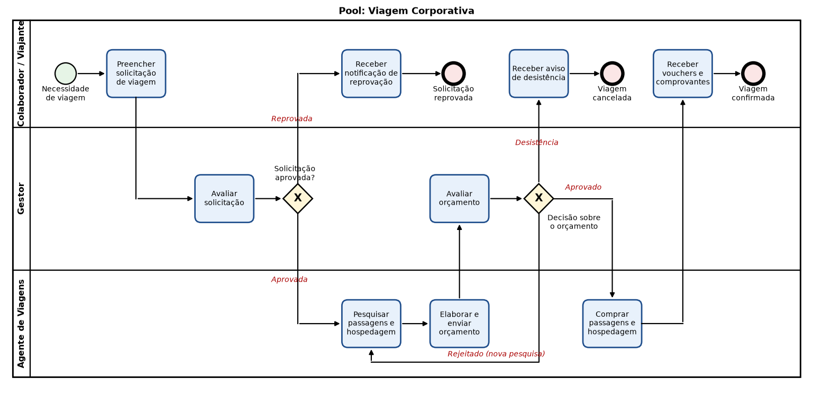

# BPMN – Solicitação de viagens corporativas

Diagrama BPMN 2.0 do processo de solicitação, avaliação e confirmação de viagens corporativas.

## Participantes e raias

- **Colaborador / Viajante** – identifica a necessidade e preenche a solicitação.
- **Gestor** – avalia a solicitação e o orçamento.
- **Agente de Viagens** – pesquisa, orça e compra passagens e hospedagem.

## Elementos usados

- 1 evento de início, 9 tarefas, 2 gateways exclusivos e 3 eventos de fim.
- 15 fluxos de sequência, incluindo o laço de retrabalho "Rejeitado", que devolve o processo ao agente de viagens.

## Decisões

1. **Solicitação aprovada?** – se reprovada, o viajante é notificado e o processo termina.
2. **Decisão sobre o orçamento** – pode ser aprovado, rejeitado (nova pesquisa) ou gerar desistência (viagem cancelada).

O fluxo termina em "Viagem confirmada" quando o agente compra passagens e hospedagem e o viajante recebe os vouchers.
