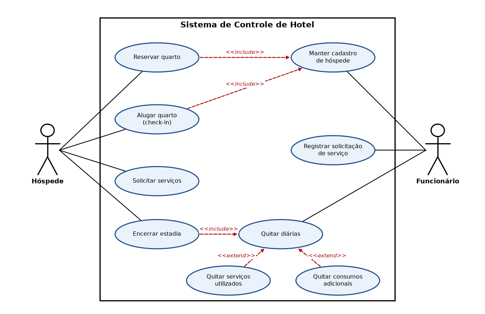

# Diagrama de casos de uso – Sistema de Controle de Hotel

Diagrama UML de casos de uso de um sistema de controle de hotel.

## Atores

- **Hóspede** – interage com o sistema durante a estadia.
- **Funcionário** – mantém cadastros e registra solicitações.

## Casos de uso

| Ator | Caso de uso |
|---|---|
| Hóspede | Reservar quarto |
| Hóspede | Alugar quarto (check-in) |
| Hóspede | Solicitar serviços |
| Hóspede | Encerrar estadia |
| Funcionário | Manter cadastro de hóspede |
| Funcionário | Registrar solicitação de serviço |
| Funcionário | Quitar diárias |
| (relacionado) | Quitar serviços utilizados |
| (relacionado) | Quitar consumos adicionais |

## Relacionamentos

- `Encerrar estadia <<include>> Quitar diárias` – o encerramento exige a quitação das diárias.
- `Reservar quarto <<include>> Manter cadastro de hóspede`
- `Alugar quarto <<include>> Manter cadastro de hóspede`
- `Quitar serviços utilizados <<extend>> Quitar diárias` – quitação opcional.
- `Quitar consumos adicionais <<extend>> Quitar diárias` – quitação opcional.
