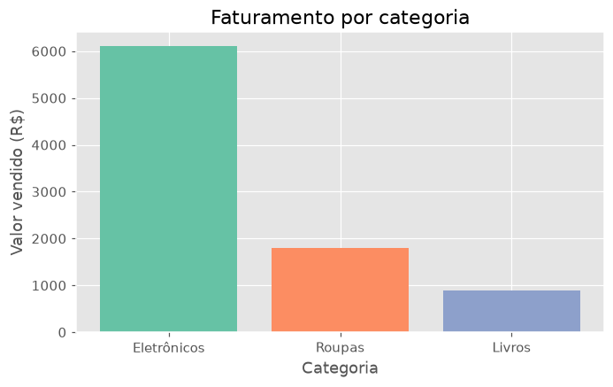
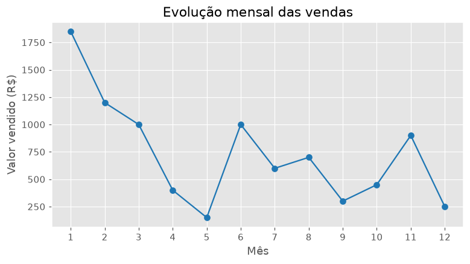
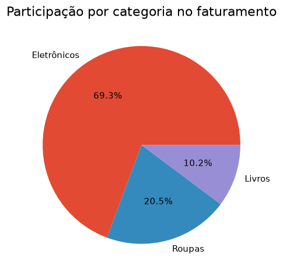

# Análise e visualização de dados de vendas

Análise de vendas de um ano de uma empresa de varejo, com dados em SQLite e gráficos.

| Faturamento por categoria | Evolução mensal | Participação |
|---|---|---|
|  |  |  |

## Etapas

1. **Banco:** conexão com o SQLite, criação da tabela `vendas1` e inserção das 14 vendas.
2. **Preparo:** leitura para um DataFrame do Pandas, verificação de nulos e tipos, conversão da data e criação da coluna de mês.
3. **Análise:** faturamento total, ticket médio, vendas por categoria e por mês.
4. **Visualização:** gráficos com Seaborn (barras e linha) e Matplotlib (pizza).

## Resultados

- Faturamento total de R$ 8.800,00 em 14 vendas, com ticket médio de R$ 628,57.
- Eletrônicos: 69,3% do faturamento. Roupas: 20,5%. Livros: 10,2%.
- Melhor mês: janeiro (R$ 1.850,00). Pior mês: maio (R$ 150,00).

## Como executar

Cole o conteúdo de `analise_vendas.py` no Google Colab. O arquivo `dados_vendas.db` é criado na execução.

## Recursos praticados

SQLite, Pandas, `groupby`, tratamento de datas, Matplotlib e Seaborn.
