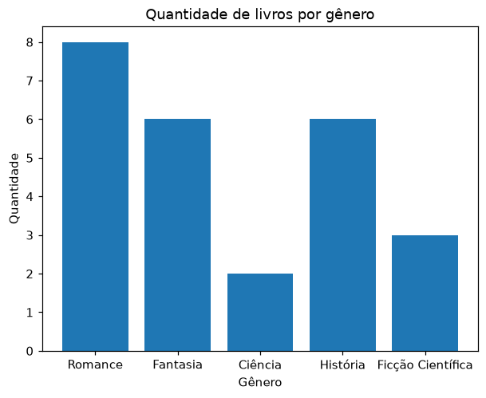

# Sistema de gerenciamento de livros

Programa em Python que gerencia o acervo de uma biblioteca, com gráfico de quantidade de livros por gênero.

## Funcionalidades

- Classe `Livro` com título, autor, gênero e quantidade disponível.
- `cadastrar_livro()` – cria um livro e o adiciona à lista.
- `listar_livros()` – mostra todos os livros cadastrados.
- `buscar_livro(titulo)` – procura pelo título sem diferenciar maiúsculas de minúsculas.
- `grafico_por_genero()` – gera o gráfico de barras com Matplotlib.

## Como executar

Cole o conteúdo de `biblioteca.py` em uma célula do Google Colab e execute. O gráfico é exibido ao final.

## Recursos praticados

Classes e objetos, listas, funções, dicionários e a biblioteca Matplotlib.
